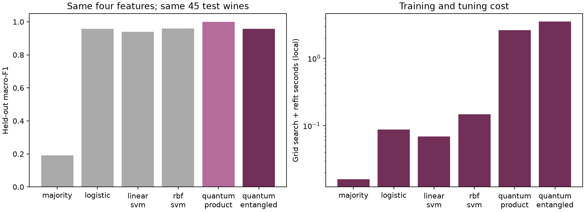

# Quantum Wine Fingerprints

**Does entanglement help a four-qubit classifier recognize wine cultivars?**

A reproducible UCI Wine benchmark with classical controls, exact quantum kernels,
and a completed, tightly budgeted IBM Quantum experiment.

The first frozen split does **not** show an entanglement benefit: the product-state
kernel gets 45/45 test wines correct, while the entangled kernel and classical RBF
SVM each get 43/45. Classical tuning is much faster. This small benchmark does not
establish quantum advantage; the product-state kernel is efficiently classically
computable, and all four-qubit kernels here are simulated classically.



## Reproduce locally

From this folder, create a Python 3.11 virtual environment and install dependencies:

```bash
python3.11 -m venv .venv
source .venv/bin/activate
python -m pip install -r requirements-lock.txt
python -m unittest -v test_model test_ibm_job
```

To reproduce the local experiments:

```bash
python benchmark.py
python pilot.py
python prepare_hardware.py
```

The [lock file](requirements-lock.txt) records tested direct dependencies;
it is not a full transitive or hash-locked environment. `benchmark.py` regenerates
the local data copy and results using the same split; rerunning is reproduction,
not a new independent trial. Tests for saved evidence run after the two experiments.

These commands do not contact IBM or consume QPU time. `prepare_hardware.py`
defaults to the offline FakeTorino target. Optional `--backend NAME` reads a real
backend through a saved account and recompiles; it still does not submit a job.

## Method

133 training rows, 45 held-out test rows; three-fold stratified training CV.
Each fold fits input standardization, four PCA components, PC standardization,
and arctan bounding. Every main model receives the same four coordinates.

The circuit applies RY(x), RZ(x/2) per qubit; the entangled variant adds adjacent
RZZ(x_i*x_j) gates. Its kernel is squared state overlap. Input-dependent gates
ensure the entangling layer does not cancel as a common final unitary would.
Scale, depth and SVM regularization are selected using training CV only.

See [experiment plan](PLAN.md), [measured results](RESULTS.md), and
[methodology and dataset references](REFERENCES.md).

## IBM pilot: completed on ibm_fez

**Hardware classified 7/9 wines correctly; the local quantum and classical pilot
controls each classified 9/9 correctly. IBM charged 52 QPU seconds.** Job ID:
`dbes98ngdj9s73fmct60`. See [full results and evidence](RESULTS.md).

- Four logical qubits; 12 training wines, nine test wines, fixed by seed.
- 186 overlap circuits, including measured self-overlaps; 1024 shots each.
- Exact, finite-shot and synthetic-noise local rehearsals completed.
- FakeTorino compilation: maximum depth 71, maximum 12 two-qubit gates; estimated
  usage about 51 seconds using that fake target's timing, reset bound and rep-delay.
- Proposed single-job cap: **360 QPU seconds**, with **120 seconds reserved** from
  the user's eight-minute total allowance. Timing estimates are not guarantees.

Live compilation estimated 50.5 seconds. The single completed job used 52 of the
user-authorized 480 seconds. No further job is planned; do not resubmit the pilot.

Runtime 0.51.0 deprecates the legacy SamplerV2. The new
`qiskit_ibm_runtime.executor_sampler.Sampler` was smoke-tested locally with Aer;
32 requested shots returned 32 counts. Use the installed API and verified options
for live submission: its options class is `qiskit_ibm_runtime.options_models.SamplerOptions`.
The corrected full configuration also passed a local smoke test on three live-compiled
circuits, and subsequently completed on hardware. The pilot circuit order is recorded in
[manifest.json](results/pilot/manifest.json), with logical and offline compiled QPY
files for review. No account secrets are stored in this project.

## Secure account setup and staged execution

The IBM commands read `QISKIT_IBM_TOKEN` and `QISKIT_IBM_INSTANCE` from the local
Git-ignored `.env` file, without printing them or saving another credential copy.
Environment variables are the fallback; a saved Qiskit account is used when neither
credential is supplied. Values are parsed as data, without shell execution or
variable interpolation. With `.env` configured, run `python ibm_access.py check`.

Alternatively, to configure a saved account, from this folder run:

```bash
../qff2026/bin/python ibm_access.py setup
../qff2026/bin/python ibm_access.py check
```

The setup prompts for the API key with hidden input and for the instance CRN.
It saves the account in Qiskit's local account store, without putting the key in
source files or shell history. Do not paste keys into chat. The check is read-only.
Setup will not overwrite an existing account with the same name.

After checking allowance and choosing the live backend, replace BACKEND_NAME:

```bash
../qff2026/bin/python prepare_hardware.py --backend BACKEND_NAME
```

Review the live preflight. Only the following explicit command consumes QPU time:

```bash
../qff2026/bin/python ibm_job.py submit
```

It verifies the saved circuit hashes, live remaining allowance, and fixed budget,
then reserves a local receipt before submission. It refuses duplicate attempts,
including after ambiguous network failures. Recover the job ID through IBM Workloads
if a connection fails during submission; never remove the receipt and blindly retry.
The collector retrieves an existing job and returns immediately if it is still queued:

```bash
../qff2026/bin/python ibm_job.py collect
```

On completion it saves counts, usage, kernels and pilot classification metrics.
Budget guards are tested with `python -m unittest -v test_ibm_job`. Remote submission
and collection completed for the recorded job. The existing receipt prevents a second
submission; `collect` retrieves the same job. Run `python plot_pilot.py` to regenerate
the hardware comparison from saved evidence without account access.

## Data and licence

Aeberhard, S. & Forina, M. (1992). *Wine* [Dataset]. UCI Machine Learning Repository.
[DOI: 10.24432/C5PC7J](https://doi.org/10.24432/C5PC7J).
The data is licensed [CC BY 4.0](https://creativecommons.org/licenses/by/4.0/).
The bundled scikit-learn copy is exported with a row ID and labels changed from
internal 0–2 to CSV cultivar 1–3. Numerical features are preserved.
See [provenance](data/provenance.json) and [CSV](data/wine.csv).

Original project code is [MIT licensed](LICENSE). Existing lab notebooks and
external references are not relicensed or copied into the code. Results were
obtained by executing the included scripts locally.

## Remaining submission work

Local experiments and the live hardware pilot are complete. Code, data attribution,
and saved results are included in this repository. A 1–3 minute video and the final
submission email remain to be completed. Suggested
video: cultivar question (20s), shared pipeline and controls (30s), comparison
chart (40s), noise pilot and limitations (30s).
