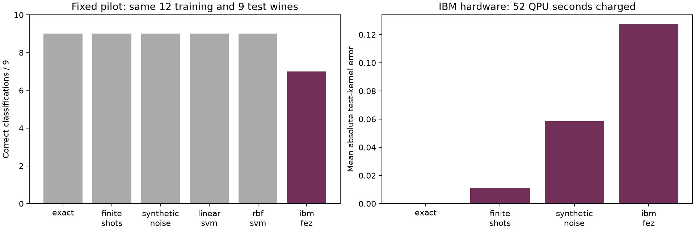

# Local and IBM hardware results — protocol v1

Watch the [project demo video](https://youtu.be/i-6KGcdVIt0) or read the
[presentation slides](presentation/Quantum_Wine_Fingerprints.pdf).

Run date: 2026-10-25. Full metrics, predictions, grids, and package versions are in
[benchmark.json](results/benchmark.json). Data split seed: 20261025.

| Model | Training CV macro-F1 | Held-out correct / 45 | Held-out macro-F1 | Search + refit seconds |
|---|---:|---:|---:|---:|
| Majority | 0.190 | 18 | 0.190 | 0.016 |
| Logistic regression | 0.944 | 43 | 0.959 | 0.087 |
| Linear SVM | 0.950 | 42 | 0.939 | 0.069 |
| RBF SVM | 0.944 | 43 | 0.959 | 0.148 |
| Product-state quantum kernel | 0.943 | 45 | 1.000 | 2.605 |
| Entangled quantum kernel | 0.943 | 43 | 0.959 | 3.521 |

Both quantum models select C=1, depth=1, scale=1. The linear SVM has the highest
selection CV score; the product-state kernel has the best score on this particular
held-out split. Do not choose further hyperparameters using these test outcomes.
The test set is only 45 wines; perfect accuracy here does not imply perfect
population accuracy. CV scores are model-selection scores rather than an unbiased
evaluation. Model grids differ in size, so timings include both algorithm cost
and the different number of tuning candidates. No hardware speedup is measured.

## Offline pilot

Separate 12-training/9-test protocol, using a deterministic subset of the frozen
partition. Preprocessing is refitted on these 12 rows. Hyperparameters came from
full training CV (so this is not a claim of learning with only 12 labelled wines).
All pilot comparators use the same subset and coordinates.

| Quantum condition | Correct / 9 | Test-kernel mean absolute error | Mean measured self-overlap |
|---|---:|---:|---:|
| Exact | 9 | 0 | 1.000 |
| 1024 shots, ideal gates | 9 | 0.0114 | 1.000 |
| 1024 shots, synthetic gate/readout noise | 9 | 0.0585 | 0.855 |

The linear and RBF SVM pilot controls also classify all nine wines correctly.
The synthetic model applies depolarizing rates 0.001 to SX/X and 0.01 to CX, plus
1.5% symmetric readout flips. It is not calibrated to a current IBM device.
Noisy similarities deteriorated without changing these nine predictions. This
does not establish general noise resilience; only one noise setting and seed were
tested. Full classical pilot results and raw counts are retained in
[pilot manifest](results/pilot/manifest.json).

Positive-eigenmode reconstruction is fitted only on the training kernel and is
applied consistently to test-to-training overlaps. All 12 modes were positive
and retained in these runs. Raw matrices and counts remain available.

## Validation and hardware readiness

- Kernel symmetry, unit diagonal and PSD; nontrivial entangling effect.
- Overlap probability matches direct statevector inner product.
- Transform does not refit on test data; saved train/CV/test indices are disjoint.
- Dataset checksum; pilot pair coverage and shot totals.
- Local client-side Runtime Sampler smoke test (32/32 counts).
- Offline FakeTorino compilation and timing: approximately 50.6 seconds, maximum
  depth 71 and 12 two-qubit gates. This is a fake-target estimate, not a forecast
  from a live backend. [Preflight evidence](results/pilot/fake_preflight.json).

## IBM hardware pilot — completed

Job `dbes98ngdj9s73fmct60` ran on `ibm_fez` on 2026-10-25. Live compilation estimated
50.5 seconds. IBM reports **52 charged QPU seconds**, within the 360-second job cap
and the user's 480-second total budget. Instance allowance before submission was
517 seconds. This project has used 52 seconds; 428 seconds of the user-authorized
budget remain unspent. Remaining account allowance may also reflect other workloads.

| Condition | Correct / 9 | Macro-F1 | Test-kernel MAE |
|---|---:|---:|---:|
| Exact quantum kernel | 9 | 1.000 | 0 |
| Finite-shot quantum kernel | 9 | 1.000 | 0.0114 |
| Synthetic-noise quantum kernel | 9 | 1.000 | 0.0585 |
| Classical linear SVM | 9 | 1.000 | n/a |
| Classical RBF SVM | 9 | 1.000 | n/a |
| IBM Fez quantum kernel | **7** | **0.756** | **0.1277** |

All 186 hardware results contain the requested 1024 shots. The mean self-overlap
was 0.7035. Training-only PSD repair retained 10 of 12 eigenmodes. Two of the nine
predictions changed from the ideal result and were incorrect. Hardware kernel
error exceeded the toy-noise rehearsal. These nine examples do not establish a
population-level accuracy or a general hardware-noise threshold; there was one
job and no hardware tuning or mitigation comparison.

The initial submission command stopped locally at Sampler construction because
Runtime 0.51 uses `options_models.SamplerOptions` for its client-side Sampler.
No receipt or remote job was created by that attempt. After correcting the import,
the capped options and three live-compiled circuits passed local sampling; exactly
one job was then submitted. Billing uses `qpu_charge_time_seconds` in the returned
metrics; the collector now also supports the older `quantum_seconds` field.

Evidence: [results](results/pilot/ibm_results.json), [job receipt](results/pilot/ibm_job.json),
[raw counts](results/pilot/ibm_counts.json), [billing metrics](results/pilot/ibm_metrics.json),
[live preflight](results/pilot/ibm_preflight.json). No additional job or retry was submitted.
